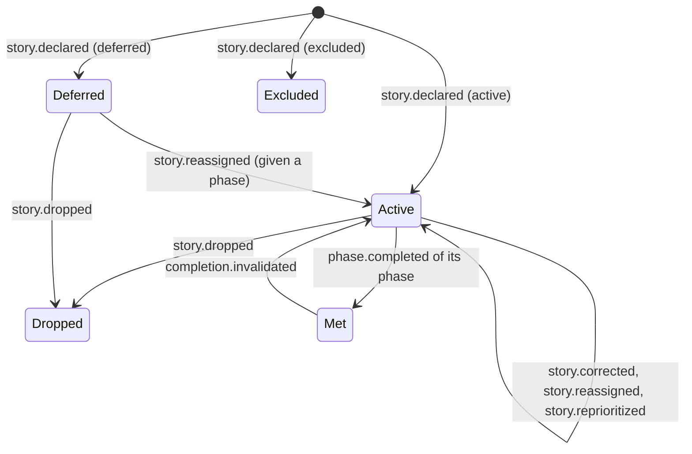
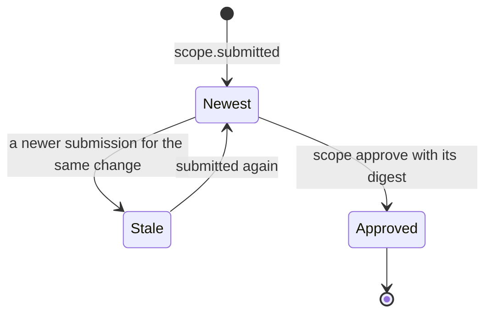
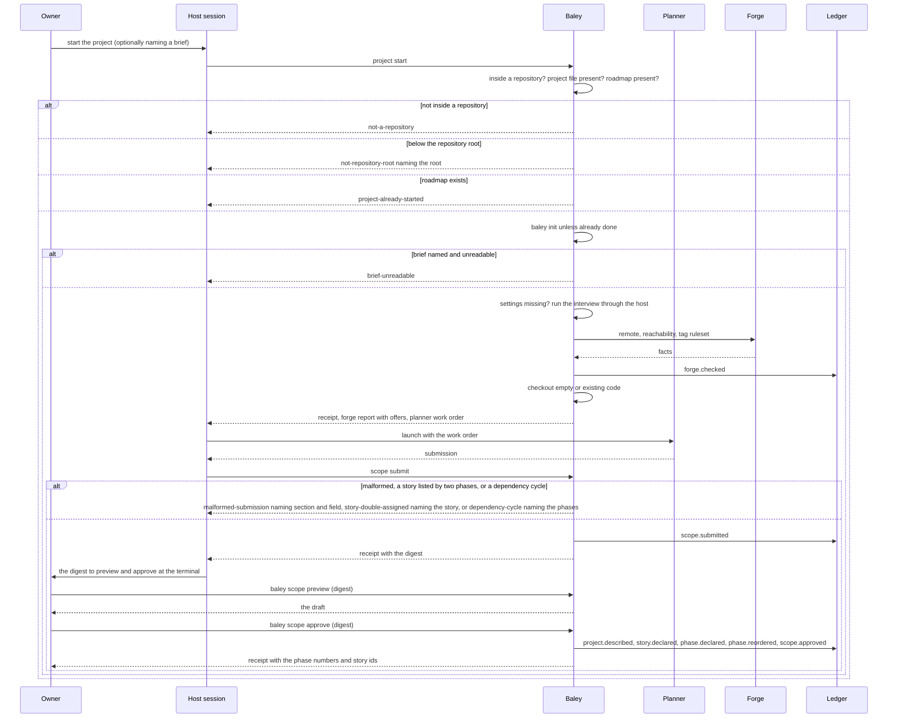
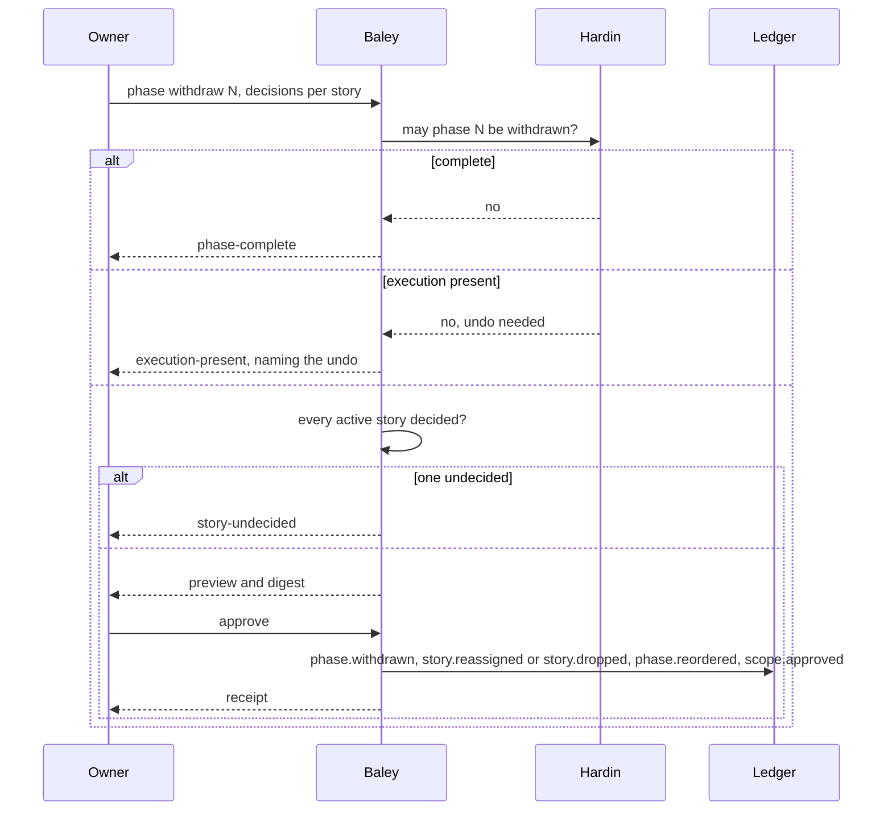

# 0004: Starting a project and changing scope

| | |
|---|---|
| Status | Accepted |
| Design issue | [#46](https://github.com/crenshawdev/baley/issues/46), [#45](https://github.com/crenshawdev/baley/issues/45); build issues [#23](https://github.com/crenshawdev/baley/issues/23), [#25](https://github.com/crenshawdev/baley/issues/25) |
| Requirement prefix | PRJ |
| Applies | [0002: System design](0002-system-design.md) |
| Related | ADRs: [0004](../adr/0004-project-identity.md), [0006](../adr/0006-no-markdown-records.md), [0007](../adr/0007-forge-anchors.md), [0009](../adr/0009-served-instructions.md), [0017](../adr/0017-stories-and-sprints.md), [0031](../adr/0031-one-term-per-concept.md) · C4 view: components ([0002](0002-system-design.md) Figure 4) |

The current design of this area, and nothing else. Edit it in place when the design changes; git holds the history. It describes the design only, never the work still to do.

## 1. Purpose and scope

This area decides how a project gets its first scope and how an approved scope changes afterwards:

- starting a project: the project description, the first stories and the first roadmap, as one submission the owner approves;
- the roadmap commands: declaring, editing, reordering and withdrawing a phase;
- the story commands: declaring, correcting, reassigning and dropping a story;
- the backlog: the stories in priority order;
- what the start checks on the forge and in the settings, and what it offers to fix.

It does not decide a story's acceptance criteria (truths), their revision, phase planning or plans ([0005: Context, plans and acceptance](0005-context-plans-and-acceptance.md)), how execution is undone ([0011: Milestones, landing, undo and pause](0011-milestones-landing-undo-pause.md)), how a repository or ruleset is created on the forge (0011), how settings are written ([0003: Configuration and routing](0003-configuration-and-routing.md)), or how the owner's identity on an approval is read ([0012: Host interface](0012-host-interface.md)).

Hand-offs: `baley init` ([0001](0001-evidence-ledger.md), EVD-R17) gives the repository its project id and file; this area's start runs it when it has not been run. The `roadmap`, `phase` and `backlog` views (section 6, [0001](0001-evidence-ledger.md)) serve what this area records to Hardin, context authoring and progress ([0013](0013-next-action-and-progress.md)). The planner that drafts the first scope is dispatched with a work order ([0002](0002-system-design.md) section 8) and routed by [0003](0003-configuration-and-routing.md).

In the component view of [0002](0002-system-design.md) (Figure 4) this area is one of the domain areas; it uses Hardin for what may happen next, the work order composer for the planner's dispatch, and the ports for the ledger, git and the forge.

## 2. Terms

| Term | Meaning |
|---|---|
| Project description | What the project is, its core value and its constraints, in the owner's words. |
| Story | One numbered statement of what the project must do, declared by the owner on the roadmap, with a status: `active`, `deferred` or `excluded`. A story carries its own acceptance criteria (truths), written in [0005](0005-context-plans-and-acceptance.md). |
| Backlog | The stories in priority order. A story in no phase waits in the backlog. |
| Phase | One working increment of the roadmap: a number, a name, a goal, detail text, dependencies on other phases, and the stories committed to it. One phase is active per project; its planning, size, capacity and close are designed in [0005](0005-context-plans-and-acceptance.md). |
| Roadmap | The ordered list of phases. |
| Scope | The description, the stories and the roadmap together. |
| Submission | A typed draft of a scope change, whole and validated, identified by its digest. It is recorded in the ledger as a draft when it is submitted, and only its approval changes accepted scope. |
| Approval | The owner's yes to one submission, given at the terminal and bound to its digest, with the owner's identity (`owner.name`, else git `user.name`) and Baley's clock. |
| Preview | The roadmap and story changes a submission would make, shown before approval. |
| Phase number | A whole number given to a phase when it is declared. It never changes and is never reused. |
| Order | The position of a phase in the roadmap: a separate fact from its number, changed by reorder. |
| Truth | One acceptance criterion of a story, in the sentence form [0005](0005-context-plans-and-acceptance.md) defines. A truth has a version. |
| Context | A phase's approved goal and the truth versions of its committed stories at the time ([0005](0005-context-plans-and-acceptance.md)). |
| Withdraw | Remove a phase from the roadmap, keeping every record of it. |
| Brief | A file the owner points the start at, holding a description of the project written elsewhere. |
| Survey | The planner's reading of an existing codebase before drafting the first scope. |

## 3. Requirements

| Id | Rule | Why | Depends on | Status |
|---|---|---|---|---|
| PRJ-R1 | One command, `project start`, starts a project in a new repository and in an existing codebase alike. Baley reads the checkout: when it holds source files and commits, the planner's work order includes a survey of what exists before drafting; when it is empty, it does not. The records are the same either way. | One contract to learn and test; Baley can tell the two cases apart itself. | SYS-P2 | Active |
| PRJ-R2 | The start's submission, the project description, the first stories and the first roadmap, is recorded as a draft when it is submitted. Its approval by the owner, by digest, records the description, the stories and the roadmap all or nothing. | Scope exists only once the owner has said yes to the whole of it. | SYS-P5, EVD-R2 | Active |
| PRJ-R3 | Every field of a submission is validated before any event is recorded; a malformed submission is refused naming the section and the field at fault. | A refusal that names the fault is fixable at once. | SYS-P3 | Active |
| PRJ-R4 | Stories carry a priority order, and an active story is committed to at most one phase that is not complete; one committed to none waits in the backlog. A submission that commits one to two such phases is refused naming the story. | The backlog is the order of what is promised; a phase commits from it. | PRJ-R3, PLN-R1 | Active |
| PRJ-R5 | A brief named with `--brief <file>` is read before anything else and handed to the planner inside its work order; an unreadable brief is refused naming the file, and nothing is recorded. | The owner's own writing is the best input, and a failure to read it must not leave a half-started project. | PRJ-R1 | Active |
| PRJ-R6 | On a repository with no project, the start runs `baley init` first; `baley init` remains its own command. On a project that already has a roadmap, the start is refused with `project-already-started`; changes go through the scope-change commands. | One front door for a new project; one record of how the project began. | EVD-R17, ADR 0004 | Active |
| PRJ-R7 | There is no research step. Reading the codebase and the problem is part of the planner's work order; only the approved submission becomes scope. | Research prose is not evidence of anything; the approved scope is. | ADR 0006 | Active |
| PRJ-R8 | The start checks the forge: a remote exists, the forge is reachable, and the tag ruleset that anchors rely on is in place; it records what it found as `forge.checked`. When something is missing it offers to create it; creation is an external step run only on the owner's approval, under claim, act, record, by [0011](0011-milestones-landing-undo-pause.md). A project with no forge runs unanchored and the ledger says so. A forge that cannot hold a tag ruleset, such as a private GitHub repository without a paid plan, is recorded as unprotected and anchoring goes on. | Anchors need a forge, and the owner should learn that at the start, not at the first landing. | ADR 0007, ADR 0026, SYS-P5, SYS-P7 | Active |
| PRJ-R9 | When the start finds no global settings file, or no settings in the project file, it runs the settings interview of [0003](0003-configuration-and-routing.md) as part of the start: the global file first when it is missing, then the project's settings. When both exist it runs nothing. The interview reaches the owner through the terminal when the start is run there, and through the host's question mechanism (HST-R9) when it is run from a session. | A new user gets a working setup in one sitting; an existing user is not asked again. | CFG-R11, HST-R9 | Active |
| PRJ-R10 | A phase's number is assigned when it is declared, as the next whole number, and never changes. Its order is a separate recorded fact, changed by `phase reorder`. Inserting a phase is declaring it and reordering it. Decimal numbers do not exist. | Every reference to a phase in the record stays true forever. | EVD-R2 | Active |
| PRJ-R11 | One phase declaration shape is used by the start, by `phase declare` and by every later edit: name, goal, detail text, dependencies on other phases, and the stories it serves. Editing records a new declaration and keeps the earlier one. | One shape to validate and serve. | PRJ-R3 | Active |
| PRJ-R12 | A phase with no execution recorded (declared, context approved, or plans approved) may be withdrawn directly. The owner decides, for each active story it served, the phase it moves to or that it is dropped, and approves the previewed roadmap and story changes. | Scope can shrink, and every promise it carried is accounted for. | PRJ-R4, PRJ-R13 | Active |
| PRJ-R13 | A phase whose execution has started is withdrawn only after its execution is undone (`phase.undone`, [0011](0011-milestones-landing-undo-pause.md)). Until then `phase withdraw` is refused with `execution-present`, naming the phase and the undo it needs. A complete phase is never withdrawn; the request is refused with `phase-complete`. | Removing a phase from the roadmap must not leave its code in the repository unaccounted for, and finished work stays finished. | SYS-P4 | Active |
| PRJ-R14 | A story's truths may be revised after they were approved, including after a phase that committed the story has started execution. A truth whose text changes gets the next version; an unchanged truth keeps its version; earlier versions are kept. The operation is [0005](0005-context-plans-and-acceptance.md)'s `story truths submit`. | The owner's understanding changes, and the record must follow it without losing history. | EVD-R2 | Active |
| PRJ-R15 | After a revision, a plan bound to an older truth version is no longer approved for execution; the phase is re-planned before more work runs, and committed code stays. A completion based on older truths stops applying. | Work is measured against the truths in force. | PRJ-R14, PLN-R4, [0007](0007-verification.md) | Active |
| PRJ-R16 | A revision is refused with `dispatch-active` while a worker is dispatched on a phase that committed the story. | A running worker must finish or be stopped under the truths it was given. | PRJ-R14 | Active |
| PRJ-R17 | A story's wording is corrected by `story edit`, at any time, for any active story; every earlier wording is kept. Correcting a story no phase serves (dropped or excluded) is refused with `story-not-served`. | One place to fix wording, and no editing of what the project no longer promises. | EVD-R2 | Active |
| PRJ-R18 | A request that names a phase, story or plan that does not exist is refused with `no-such-phase`, `no-such-story` or `no-such-plan`, naming it. "Unavailable" is answered only for a temporary condition. | A mistake must read as a mistake. | SYS-P10 | Active |
| PRJ-R19 | Every scope change (project start; phase declare, edit, reorder and withdraw; story declare, edit, reassign and drop; backlog reorder; and a revision of a story's truths, `story truths submit` in [0005](0005-context-plans-and-acceptance.md)) is a submission with a preview and an owner approval by digest, recorded as events that keep every earlier record. | Scope changes only with a record of what changed, who approved it and when. | SYS-P5, SYS-P6 | Active |
| PRJ-R20 | The project description is recorded as `project.described` on the project stream and served to refinement and planning ([0005](0005-context-plans-and-acceptance.md)) beside the roadmap. It is revised the same way as any scope change. | The planner and the analyzer work from what the owner said the project is. | PRJ-R2 | Active |

## 4. Roles and actors

| Actor | Receives | Returns | Model and effort from |
|---|---|---|---|
| Owner | Previews; the interview questions; the forge report and offers | The description and answers in the session; approvals by digest at the terminal; story decisions on a withdraw | Not applicable |
| Planner (dispatched worker) | A work order: the project description so far, the brief if any, the survey instruction when the checkout has code, the declaration shape, the truth and story rules | A typed submission: description, stories, roadmap | `roles.planner.model`, `roles.planner.effort` ([0003](0003-configuration-and-routing.md)) |
| Host session | The planner's work order to launch; the submission receipt with its digest; the questions to relay | The planner's submission; the owner's answers. Never an approval | Not applicable |
| Baley: this area | Submissions and approvals | Previews, refusals, receipts, events | Not applicable |
| Hardin ([0002](0002-system-design.md)) | A scope change request | Whether it may happen now (execution present, dispatch active, phase complete) | Not applicable |
| Forge adapter ([0011](0011-milestones-landing-undo-pause.md)) | A check request; a create request on approval | Remote, reachability and ruleset facts; the created repository or ruleset | Not applicable |

The analyzer and the plan checker take no part in this area; they act on a story's refinement and a phase's plans ([0005](0005-context-plans-and-acceptance.md)).

## 5. Commands and operations

Every operation here is implemented once in the library and served as a typed operation on the host interface, reachable from a session through the stub skill that names it ([ADR 0009](../adr/0009-served-instructions.md)). The owner's own acts and reads also have commands under `baley project`, `baley scope`, `baley phase`, `baley story` and `baley backlog`, the same `baley story` namespace that holds the refinement operations of [0005](0005-context-plans-and-acceptance.md), and each command calls the same function as the operation a session calls ([ADR 0044](../adr/0044-owner-acts-on-the-command-line.md)). Every approval is the exception: it is given only on the command line and is never served over MCP, because over MCP the call comes from the model and nothing proves a person answered, while the sandbox keeps agents from running the command line against Baley's home, where the ledger lives. A submission comes from the planner's work, so `scope submit` is served to a session only.

Each change follows the same three steps: submit (the submission is recorded as a draft and its digest returned), approve (the owner's yes to that digest, at the terminal), record (the approval's events). Every submission is recorded in the ledger as a draft when it is submitted ([ADR 0043](../adr/0043-submissions-recorded-as-drafts.md)). A draft survives a restart, can be read by its digest from any session or from the terminal, and can be approved until a newer submission for the same change is recorded; the newer one is then the newest draft, even when it repeats an earlier digest. The end of a session discards no draft. Recording a submission changes no accepted scope: only an approval does.

### project start

- **Inputs:** the working directory; optional `--brief <file>`.
- **Outputs:** a receipt naming what the start did and found: `baley init` run or already done; settings interview run or not needed; the forge report (`forge.checked`) with any offer to create; the checkout classification (empty or existing code); the planner's work order id.
- **Refusals:**

  | Code | When | Requirement |
  |---|---|---|
  | `not-a-repository` | The directory is not inside a git repository | EVD-R17 |
  | `not-repository-root` | The directory is inside a git repository but is not its root (names the root) | EVD-R17 |
  | `project-name-required` | The repository root has no folder name Baley can use as the project's name (fix: `baley init --name <name>`) | EVD-R17 |
  | `project-already-started` | The project already has a roadmap | PRJ-R6 |
  | `brief-unreadable` | The brief cannot be read (names the file) | PRJ-R5 |
  | `config-unavailable` | Inherited from `baley init`: `baley.toml` is not a regular file, cannot be read, does not parse, lacks the project's id or name, or holds an id that is not a lower-case UUID version 4 (names the file); the global file is not a regular file, cannot be read or is invalid, or HEAD's copy of `baley.toml` cannot be read or is invalid (names the file and the fault); or the repository root, or a settings file's path, is not UTF-8 (names the path). Also when the settings cannot be read after the interview | EVD-R17, CFG-R9 |

### scope submit

- **Inputs:** the submission, judged whole. It has exactly the members below, and an unknown member anywhere in it is refused:
  - `description`: `what` and `core_value`, each text, and `constraints`, a list of text that may be empty;
  - `stories`: a list of at least one story, in priority order, each with a `label` that no other story in the submission has, a `sentence`, and a `status` of `active`, `deferred` or `excluded`;
  - `roadmap`: a list of at least one phase, in roadmap order, each with a `name`, a `goal` and a `detail`, each text, `depends_on`, the phases it depends on as 1-based positions in `roadmap`, and `stories`, the active stories it serves, by label.

  Text is taken as written and must not be empty or only whitespace. The submission names no phase number and no story id: phases refer to each other by position and to stories by label, and Baley assigns numbers and ids at approval. It carries no work order id. Over MCP the operation is `scope-submit` on `baley_apply`, with a `request_id`, a UUID in lowercase hyphenated form that a retry of the same submission repeats, and the `submission`; an argument other than those two is refused `invalid-arguments`, and so is a `request_id` in any other form.
- **Outputs:** `scope.submitted` on the `project` stream, with the submission's canonical JSON stored as a `record` payload, and the receipt: `status` `ok`, the `digest`, the `kind` `start`, the number of `stories` and of `phases`, and `recorded_at`. The receipt never holds the submission. The digest is the SHA-256 of the submission's canonical JSON and nothing else, so the same content has one digest from any session. Every submit records, so submitting a digest again makes it the newest draft again.

  The preview is read by the digest: by a session with `document` and the identity `{"kind": "draft", "digest": "<digest>"}`, and by the owner with `baley scope preview <digest>`. Both give the draft as its latest submission recorded it, with stories by label and phases by position, since numbers and ids do not exist before approval. Neither records anything. A digest no submission has is `unknown-draft`; over MCP a digest not written as 64 lowercase hexadecimal characters names no draft and is answered `unknown-draft` without a read, and on the command line it is refused before the ledger is read. A draft whose body this project purged answers its tombstone and this project's purge reason, and its body is never opened, even when another project holds the same bytes ([0001](0001-evidence-ledger.md)).
- **Refusals:** judged in this order: the shape, member by member in the order of the inputs above, then story assignment, then dependency cycles, then whether the project's start is approved. So one submission always gets one answer.

  | Code | When | Requirement |
  |---|---|---|
  | `malformed-submission` | A member is missing, null, blank, of the wrong type or unknown; `stories` or `roadmap` is empty; two stories share a label; a `depends_on` entry is not a position in `roadmap` or is repeated; a phase's `stories` entry is repeated, names a label the submission lacks, or names a story that is not `active`. The details name the `section` and the `field` as a path with zero-based list indexes, such as `roadmap[1].goal` | PRJ-R3 |
  | `story-double-assigned` | Two phases list one story. The details name the story by label and the first two phases that list it, by 1-based position | PRJ-R4 |
  | `dependency-cycle` | Phases depend on each other in a cycle, including a phase that depends on itself. The details name every phase on a cycle by 1-based position, ascending | PRJ-R11 |
  | `project-already-started` | The project's start is approved: a `scope.approved` of kind `start` exists | PRJ-R6 |

  A body identical to one purged from the ledger cannot be stored again, and the call is answered `failed` `text-purged` with nothing recorded. The same `request_id` with a different submission is refused `request-id-reuse`.

### scope approve

- **Inputs:** the draft's digest alone, as the receipt writes it: 64 lowercase hexadecimal characters. Anything else is refused before the ledger is read. The owner and the time are Baley's: the owner is `owner.name` from the global settings, else git `user.name` ([0012](0012-host-interface.md) HST-R10), and the time is Baley's clock when the approval is recorded. Nothing a caller sends supplies either.
- **Outputs:** in one transaction, in this order: `project.described`; one `story.declared` per story, in submission order, with ids Baley assigns as the next whole numbers after the highest story id ever declared; one `phase.declared` per phase, in roadmap order, numbered as the next whole numbers after the highest phase number ever declared, withdrawn phases included, with its dependencies as phase numbers, its stories as story ids and its detail stored as a `record` payload; one `phase.reordered` with the new numbers in roadmap order; and `scope.approved` last, binding the digest, with the owner's name and Baley's time. Every event is recorded with actor `owner`. A story's `phase` is the number of the phase that lists it, or none when no phase does. The receipt gives the kind, the digest, the owner, the time, the assigned phase numbers in roadmap order and the assigned story ids in submission order, and the command prints them as three lines, exit 0.
- **Refusals:** judged in this order, so one approval always gets one answer. Each prints `<code>: <reason>`, a stale draft's followed by the path, and exits 2.

  | Code | When | Requirement |
  |---|---|---|
  | `unknown-draft` | No draft has the digest, or its `scope.submitted` is not found among the events | PRJ-R19 |
  | `project-already-started` | The project's start is approved. Judged before staleness, so once one start draft is approved, approving any other start draft is refused this way, not with `stale-draft` | PRJ-R6 |
  | `stale-draft` | A newer submission of the same kind was recorded after this draft's latest submission. The details name the first differing part as a path into the content, looked for in member order (the description, then the stories entry by entry, then the roadmap entry by entry), such as `roadmap[1].goal` | PRJ-R19 |

  Run outside a checkout of a project it is refused `not-a-project`, and for a project the ledger does not list, `project-not-in-ledger`. With neither `owner.name` nor git `user.name` readable it is refused `owner-identity-missing`, naming both ways to set one; that refusal comes after checkout admission and the policy step, whose records stand. A draft whose body this project purged, or whose body no longer judges as the submission its digest names, is never approved: the answer is `failed` `ledger-unavailable`, exit 1. So is an approval whose numbering would pass the largest phase number or story id Baley can hold (4,294,967,295), and its transaction records nothing, since wrapping would reuse a number.

  Served on the command line only, as `baley scope approve <digest>`, and never over MCP: over MCP the call comes from the model and nothing proves a person answered, while the sandbox keeps agents from running the command line against Baley's home, where the ledger lives ([ADR 0044](../adr/0044-owner-acts-on-the-command-line.md)). `baley_apply` has no `scope-approve` spelling, so a call spelled that way is refused `unknown-operation`.

### Refusals judged against the ledger

A `scope submit` or `scope approve` refusal judged against the ledger records nothing at all. It is judged from the ledger before the write is prepared: over MCP after the replay lookup and before the settings are read, on the command line before checkout admission. So no checkout admission (`checkout.seen`), no policy step (`policy.effective`) and no `command.completed` is recorded for it. A refusal of the submission's content is judged before the ledger is read at all.

A retry of a `scope submit` request already completed, the same `request_id` with the same submission, is answered with its recorded receipt and never refused `project-already-started`, even when the start was approved since. When the start-once check refuses, the request is looked up again first, so a request recorded since the first lookup is replayed rather than refused. Each `baley scope approve` is a new request, so it has no retry by id: running it again after its approval is judged afresh and refused `project-already-started`.

When another submission or approval lands between a call's judgement and its transaction, that transaction records nothing. A submission's transaction confirms that no start approval exists. An approval's confirms that the draft's latest submission, its `scope.submitted`, the absence of a start approval and the newest start draft are what the judgement read. When any of them moved, the call is answered `failed` `ledger-busy`, retryable, and the retry is judged afresh. The checkout admission and policy step recorded before the transaction stand.

### phase declare

- **Inputs:** the declaration shape: name, goal, detail, dependencies, stories served; optional position (default: last).
- **Outputs:** preview and digest; on approval `phase.declared` with the next number and `phase.reordered`.
- **Refusals:** `malformed-submission`, `story-double-assigned`, `dependency-cycle`, `no-such-story`, `no-such-phase` (a dependency that does not exist) (PRJ-R3, PRJ-R4, PRJ-R11, PRJ-R18).

### phase edit

- **Inputs:** a phase number and the fields that change (name, goal, detail, dependencies, stories served).
- **Outputs:** preview and digest; on approval a new `phase.declared` for the same number, keeping the earlier one.
- **Refusals:** as `phase declare`, plus `no-such-phase`, plus `phase-complete` when the stories served would change on a complete phase (PRJ-R13).

### phase reorder

- **Inputs:** the full order of phase numbers.
- **Outputs:** preview and digest; on approval `phase.reordered`.
- **Refusals:** `no-such-phase`, `order-incomplete` (a phase missing or repeated), `dependency-order` (a phase placed before one it depends on) (PRJ-R10, PRJ-R11, PRJ-R18).

### phase withdraw

- **Inputs:** a phase number; for each active story it serves, the phase it moves to or `drop`.
- **Outputs:** preview (the roadmap without the phase, the stories' new phases or dropped status) and digest; on approval `phase.withdrawn`, one `story.reassigned` or `story.dropped` per story, `phase.reordered`.
- **Refusals:**

  | Code | When | Requirement |
  |---|---|---|
  | `no-such-phase` | The phase does not exist | PRJ-R18 |
  | `execution-present` | Execution has started and is not undone (names the phase and the undo) | PRJ-R13 |
  | `phase-complete` | The phase is complete | PRJ-R13 |
  | `story-undecided` | An active story it serves has no decision (names it) | PRJ-R12 |
  | `no-such-phase` | A story is moved to a phase that does not exist | PRJ-R18 |

### story declare, story edit, story reassign, story drop

- **Inputs:** `declare`: sentence, status, phase served. `edit`: id, new sentence. `reassign`: id, new phase. `drop`: id.
- **Outputs:** preview and digest; on approval `story.declared`, `story.corrected`, `story.reassigned` or `story.dropped`.
- **Refusals:**

  | Code | When | Requirement |
  |---|---|---|
  | `no-such-story` | The id does not exist | PRJ-R18 |
  | `no-such-phase` | The phase does not exist | PRJ-R18 |
  | `story-not-served` | `edit` on a dropped or excluded story | PRJ-R17 |
  | `story-shipped` | `reassign` or `drop` on a story a complete phase served | PRJ-R13 |
  | `malformed-submission` | Blank sentence or unknown status | PRJ-R3 |

### backlog reorder

- **Inputs:** the full priority order of active and deferred story ids.
- **Outputs:** preview and digest; on approval `story.reprioritized`.
- **Refusals:** `no-such-story`, `order-incomplete` (an id missing or repeated) (PRJ-R4, PRJ-R18).

### Revising a story's truths

The operation is `story truths submit` and `story truths approve` in [0005](0005-context-plans-and-acceptance.md); PRJ-R14 to PRJ-R16 are the rules it applies to a story already committed to a phase.

## 6. Records

### scope.submitted (event, `project` stream)

| Field | Type | Meaning |
|---|---|---|
| `digest` | digest | The SHA-256 of the submission's canonical JSON, its identity as a draft |
| `kind` | enum | The change kind, as in `scope.approved` |
| `body` | payload reference | The submission's canonical JSON as a `record` payload, which the event attaches |

Recorded once per submit, a repeated digest included. The accepted scope views ignore it.

### project.described (event, `project` stream)

| Field | Type | Meaning |
|---|---|---|
| `what` | text | What the project is |
| `core_value` | text | The one thing it must do well |
| `constraints` | list of text | What it must not do or depend on |
| `submission` | digest | The submission this came from |

### story.declared, story.corrected, story.reassigned, story.reprioritized, story.dropped (events, `roadmap` stream)

| Field | Type | Meaning |
|---|---|---|
| `id` | integer | The story id: a whole number from 1, assigned by Baley at declaration as the next after the highest ever declared, never reused |
| `sentence` | text | The wording (declared, corrected) |
| `status` | `active`, `deferred`, `excluded`, `dropped` | The status after the event |
| `phase` | phase number or null | The phase it is committed to (declared, reassigned); null means the backlog |
| `order` | list of story ids | The full priority order after the event (reprioritized) |
| `submission` | digest | The submission this came from |

### phase.declared, phase.reordered, phase.withdrawn (events, `roadmap` stream)

| Field | Type | Meaning |
|---|---|---|
| `number` | integer | The phase's permanent number (declared, withdrawn) |
| `name`, `goal` | text | (declared) |
| `detail` | payload reference | The detail text as a `record` payload (declared) |
| `depends_on` | list of phase numbers | (declared) |
| `stories` | list of story ids | The active stories served (declared) |
| `order` | list of phase numbers | The full order after the event (reordered) |
| `submission` | digest | The submission this came from |

### scope.approved (event, `project` stream)

| Field | Type | Meaning |
|---|---|---|
| `submission` | digest | The approved submission |
| `kind` | enum | `start`, `phase-declare`, `phase-edit`, `phase-reorder`, `phase-withdraw`, `story-declare`, `story-edit`, `story-reassign`, `story-drop`, `backlog-reorder`. A revision of a story's truths is approved by `story truths approve` and recorded as `story.refined` ([0005](0005-context-plans-and-acceptance.md)), not here |
| `owner` | text | The owner's identity: `owner.name` from the global settings, else git `user.name` |
| `at` | time | Baley's clock when the approval was recorded, the same as the command's time |

The event is recorded with actor `owner`, as is every event its approval records.

### forge.checked (event, `project` stream)

| Field | Type | Meaning |
|---|---|---|
| `remote` | URL or absent | The remote found |
| `reachable` | bool | Whether the forge answered |
| `ruleset` | `present`, `missing`, `unknown` | The tag ruleset anchors rely on |
| `offered` | list | What the start offered to create |

### story.refined (event, `roadmap` stream; defined in [0005](0005-context-plans-and-acceptance.md))

This area adds one rule to it: each truth carries a `version`, and a revision records a new `story.refined` whose unchanged truths keep their versions.

### Views

Every view is kept per project, and only `draft` reads a submission. The accepted scope views, `roadmap`, `phase`, `phase_detail` and `backlog`, change only on the events an approval records.

| View | Key | Content |
|---|---|---|
| `draft` | project, digest | One document per submitted digest: the change kind, the sequence and time of that digest's latest submission, and its body's hash, never the body. Its `newest` index lists a kind's drafts newest first by that sequence, so the newest draft of a change is the first it gives. When this project purges the body, the document gains `state` `purged` and the purge's reason and is kept, so a read answers the tombstone and never opens the body ([0001](0001-evidence-ledger.md)) |
| `roadmap` | project | One document: the latest project description; the declared phases by number, each with name, goal, dependencies, stories and status; the latest phase order; the stories in priority order, each with id, wording, status, phase and truth count; and the highest phase number and story id ever declared, which never go down, so an approval numbers past every declaration, withdrawn phases included |
| `phase` | project, phase number | One document per declared phase: name, goal, dependencies, stories, status, the approving digest, the declaration's time and sequence, and the detail body's hash, never the text. Its `by_status` index lists phases by status, then number. A later declaration of the same number replaces the document. The current context (truth versions), plans, execution and completion state Hardin needs are added by the events that record them |
| `phase_detail` | project, `phase.declared` sequence | One document per phase declaration: the phase number and the detail body's hash. It is keyed by the declaration's sequence because a purge names each released body by sequence and hash; a `phase` document names its sequence. When this project purges the body, the document gains `state` `purged` and the purge's reason, so a phase read answers them and never opens the body |
| `backlog` | project | One document: the stories in priority order, each with id, wording, status, phase, refinement, truth count and size, the view [0005](0005-context-plans-and-acceptance.md) reads. Refinement is `unrefined`, the truth count 0 and the size none until refinement and sizing record them |

## 7. States

```mermaid
stateDiagram-v2
  [*] --> Declared: phase.declared
  Declared --> Declared: phase.declared (edit), phase.reordered
  Declared --> ContextApproved: every committed story refined (story.refined)
  ContextApproved --> ContextApproved: story.refined (revision)
  ContextApproved --> Planned: plan.approved
  Planned --> ContextApproved: story.refined (revision; plans invalid)
  Planned --> Executing: first task admitted
  Executing --> Planned: phase.undone
  Executing --> Complete: phase.completed
  Complete --> Executing: completion.invalidated
  Declared --> Withdrawn: phase.withdrawn
  ContextApproved --> Withdrawn: phase.withdrawn
  Planned --> Withdrawn: phase.withdrawn
  Withdrawn --> [*]
```

*Figure 1. States of a phase as this area sees them. Execution and completion transitions belong to [0006](0006-execution.md) and [0007](0007-verification.md); a withdraw from Executing is refused until `phase.undone` returns it to Planned; Complete is never withdrawn.*

*Figure 2. States of a story. Excluded and Dropped are final; Met is derived from its phase's completion ([0007](0007-verification.md)).*

*Figure 3. States of a submission. Every submission is recorded as a draft when it is submitted, and its record stays in every state. Only the newest draft of a change can be approved, and only its approval records scope events. The end of a session changes no state. Once a start is approved, approving any other start draft is refused `project-already-started`, and a draft whose body this project purged is never approved.*

## 8. Workflows

*Figure 4. Starting a project. The session submits the planner's submission, which is recorded as a draft. The owner previews and approves it by its digest at the terminal, not through the session, and Baley adds the owner's identity and its own time to the approval.*

*Figure 5. Withdrawing a phase.*

The revision of a story's truths is [0005](0005-context-plans-and-acceptance.md) Figure 4.

## 9. Settings

Not applicable. This area reads no setting of its own. The start runs the settings interview of [0003](0003-configuration-and-routing.md) when settings are missing (PRJ-R9), and the planner's route comes from `roles.planner.model` and `roles.planner.effort` ([0003](0003-configuration-and-routing.md)).

## 10. Instructions served

| Instruction | Served to | Carries requirements |
|---|---|---|
| Start planner | The planner, inside the start work order: the description so far, the brief, the survey instruction when the checkout has code, the declaration shape, the story statuses, the assignment rule, the truth rules of [0005](0005-context-plans-and-acceptance.md) | PRJ-R1, PRJ-R4, PRJ-R7, PRJ-R11 |
| Scope change stubs | The host session, as the stub skills for project start, scope, phase, story and backlog: which operation to call and that the owner approves the preview | PRJ-R19 |

## 11. Build status

The binary parks the inherited engine for Build 9 to delete, and nothing in production reaches it (`crates/baley/src/inherited.rs:1-4`). Build 4 T3 built the start's scope records. A session submits a start submission with `scope-submit` on `baley_apply` (`crates/baley/src/mcp/operations.rs:198`, `crates/baley/src/mcp/scope.rs:141-188`), which records it as a draft (`crates/baley/src/scope/submit.rs:93-139`), and reads a draft, the accepted roadmap and an accepted story with `document` (`crates/baley/src/mcp/document.rs:245-259`). The owner has `baley scope approve`, `baley scope preview`, `baley scope show`, `baley phase show`, `baley backlog show` and `baley story show` (`crates/baley/src/main.rs:33-40`, `crates/baley/src/scope/command.rs:116-152`). `baley_apply` has no `scope-approve` spelling, so approval is given only on the command line (`crates/baley/src/scope/command.rs:235-294`). The six scope events and the five scope views are registered in view set 9 (`crates/baley/src/ledger/open.rs:24-68`). The session server answers `plan-read` and `context-intake` (`crates/baley/src/mcp/operations.rs:107-108`) and `plan-submit` and `context-submit` (`crates/baley/src/mcp/operations.rs:156-157`) as `operation-unavailable`, and the operation baseline names Build 4 for them. It answers `verification-complete` (`crates/baley/src/mcp/operations.rs:136`), the roadmap tick, the same way and names Build 5. `project start`, its planner's work order and the binding of a submission to that work order are Build 4 T5, and the phase, story and backlog change commands and the description's revision are Build 4 T4. Production reaches `baley init` in this area (`crates/baley/src/init.rs:556-565`). Parsing and editing `ROADMAP.md` and `REQUIREMENTS.md` under `.planning/` is the parked engine's.

| Requirement | Status | Where |
|---|---|---|
| PRJ-R1, PRJ-R5 | Not built | No start operation exists. `project start`, the survey and the brief are Build 4 T5 |
| PRJ-R2 | Partly built | A start submission is recorded as a draft, the body as a `record` payload and one `scope.submitted` (`crates/baley/src/scope/submit.rs:93-139`), and its approval records the description, the stories and the roadmap in one transaction (`crates/baley/src/scope/approve.rs:100-180`, `crates/baley-core/src/scope/approval.rs:149-250`). The start operation that dispatches the planner is Build 4 T5 |
| PRJ-R3 | Partly built | A start submission is judged whole, its shape before story assignment and cycles, and a fault is `malformed-submission` naming the section and the field path (`crates/baley-core/src/scope/submission.rs:162-364`), answered before anything is prepared or recorded (`crates/baley/src/mcp/scope.rs:57-101`). The change commands' submissions are Build 4 T4 |
| PRJ-R4 | Partly built | A start submission listing one story in two phases is refused `story-double-assigned` (`crates/baley-core/src/scope/submission.rs:366-385`), and a phase listing a story that is not `active` is `malformed-submission` (`crates/baley-core/src/scope/submission.rs:338-353`). The stories keep the submission's order as their priority order in the `backlog` view (`crates/baley-core/src/scope/backlog.rs:39-126`). The backlog reorder and the rule against a phase that is complete are Build 4 T4 |
| PRJ-R6 | Partly built | `project-already-started` is judged from the events at submit (`crates/baley/src/scope/submit.rs:41-91`) and at approval, ahead of staleness (`crates/baley-core/src/scope/approval.rs:58-82`), and confirmed inside each transaction (`crates/baley/src/scope/submit.rs:128-137`, `crates/baley/src/scope/approve.rs:182-205`). `baley init` is built as its own command (`crates/baley/src/init.rs:556-565`); the start operation that runs it is Build 4 T5 |
| PRJ-R7 | Partly built | The accepted scope views ignore `scope.submitted`, so only an approved submission becomes scope (`crates/baley-core/src/scope/roadmap.rs:39-83`). The planner's work order is Build 4 T5 |
| PRJ-R8, PRJ-R9 | Not built | |
| PRJ-R10 | Partly built | An approved start numbers its phases after the highest ever declared and records one `phase.reordered` with the full order (`crates/baley-core/src/scope/approval.rs:149-268`); the `roadmap` view keeps the highest number, never lowering it (`crates/baley-core/src/scope/roadmap.rs:135-162`). `phase reorder` and inserting a phase are Build 4 T4 |
| PRJ-R11 | Partly built | The start's phases use the declaration shape, name, goal, detail, dependencies and stories (`crates/baley-core/src/scope/submission.rs:28-31, 305-364`), and a dependency cycle is refused `dependency-cycle` (`crates/baley-core/src/scope/submission.rs:387-457`). A later declaration of a number replaces its `phase` document and keeps the earlier event (`crates/baley-core/src/scope/phase.rs:65-144`). `phase declare` and `phase edit` are Build 4 T4 |
| PRJ-R12, PRJ-R13 | Not built | No phase withdraw exists. The parked engine edits `ROADMAP.md` only to tick a phase (`crates/baley/src/verification/completion.rs:264-303`), and the session server answers `verification-complete` as unavailable (`crates/baley/src/mcp/operations.rs:136`) until Build 5 |
| PRJ-R14, PRJ-R15, PRJ-R16 | Not built | The parked engine refuses a second context approval `native-context-exists` (`crates/baley/src/context_service.rs:184-193`), writes truth version 1 always (`crates/baley/src/context/persistence.rs:33-49`), and its plan check accepts only version 1 (`crates/baley/src/plan/limits.rs:401-408`). The session server answers `context-submit` and `plan-submit` as unavailable (`crates/baley/src/mcp/operations.rs:156-157`) until Build 4 |
| PRJ-R17 | Not built | |
| PRJ-R18 | Partly built | A capture naming a phase the `phase` view does not hold is refused `no-such-phase` (`crates/baley/src/mcp/capture.rs:233-250`), and `baley phase show`, `baley story show` and `document` refuse a phase or story the accepted scope lacks with `no-such-phase` or `no-such-story` (`crates/baley/src/scope/read.rs:376-451`, `crates/baley/src/scope/command.rs:625-641`, `crates/baley/src/mcp/document.rs:328-337`). The change commands' refusals are Build 4 T4, and `no-such-plan` is Build 4 |
| PRJ-R19 | Partly built | The start submission is recorded as a draft with its digest, and approved by that digest at the terminal with `unknown-draft`, `project-already-started` and `stale-draft` (`crates/baley-core/src/scope/approval.rs:58-147`, `crates/baley/src/scope/approve.rs:48-98`). The other scope changes are Build 4 T4, and a revision of a story's truths is Build 4 T7 |
| PRJ-R20 | Partly built | An approved start records `project.described` on the `project` stream (`crates/baley-core/src/scope/approval.rs:182-188`), the `roadmap` view holds it (`crates/baley-core/src/scope/roadmap.rs:106-114`), and `baley scope show` and `document` print it. Serving it to refinement and planning is Build 4 T7 and T9, and its revision is Build 4 T4 |

## 12. Open questions

| Question | Decided by |
|---|---|
| None | |
